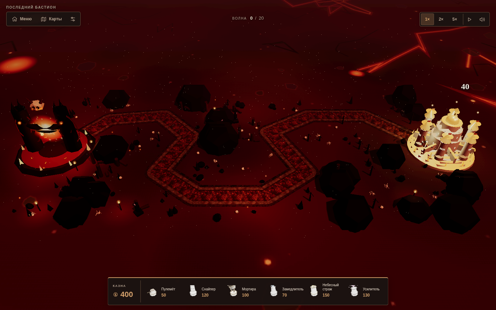
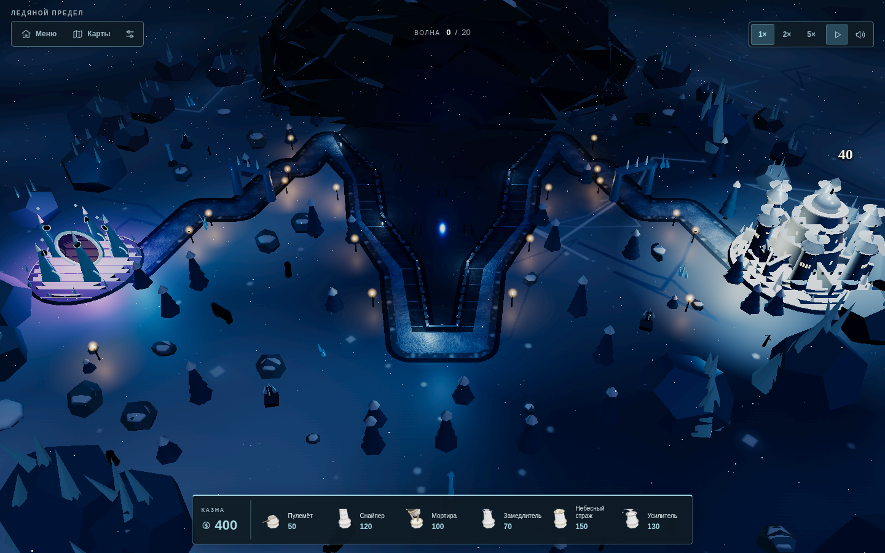
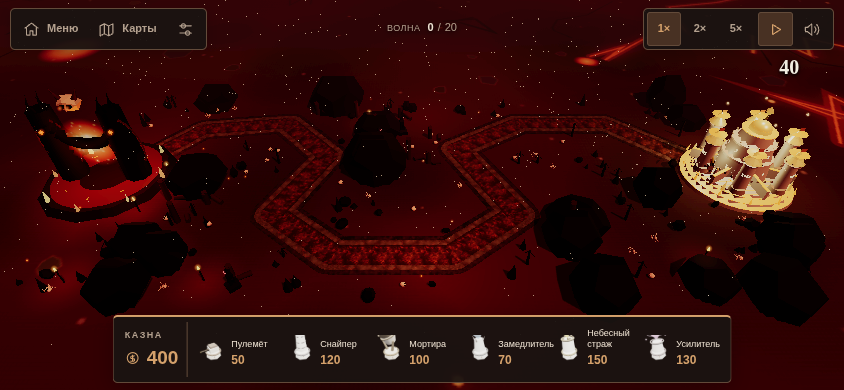
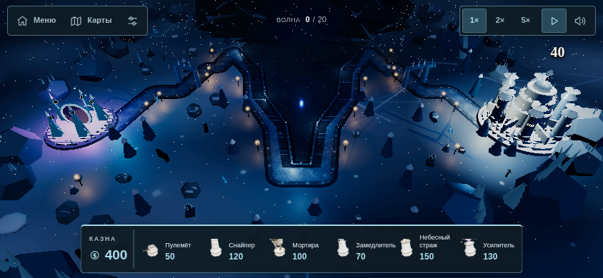

# Предварительный просмотр игрового интерфейса

Изменения подготовлены в ветке `preview/game-ui`. Основная ветка `main` и опубликованный сайт не обновлялись.

Кнопки и карточки оформлены в цветах каждой карты. Таймер появления врагов убран, монеты перенесены к покупке башен, оставшееся здоровье показано числом над базой. Камера учитывает панели интерфейса, чтобы площадки для строительства оставались доступны.

## Карта «Ад» — компьютер

Нажмите на изображение, чтобы открыть его в полном размере.

## Карта «Лёд» — компьютер

## Карта «Ад» — телефон

## Карта «Лёд» — телефон

## Проверки

Обе карты проверены в Chromium с мышью и сенсорным управлением: скорости, пауза, звук, окна карт и правил, покупка, улучшение и продажа башен, обновление монет и здоровья, появление врагов. Проверены размеры окна от 568×320 до 1440×900: все 25 площадок «Ада» и 19 площадок «Льда» остаются доступны.

Скриншоты получены из работающей игры. Сайт отдельно не публиковался.
